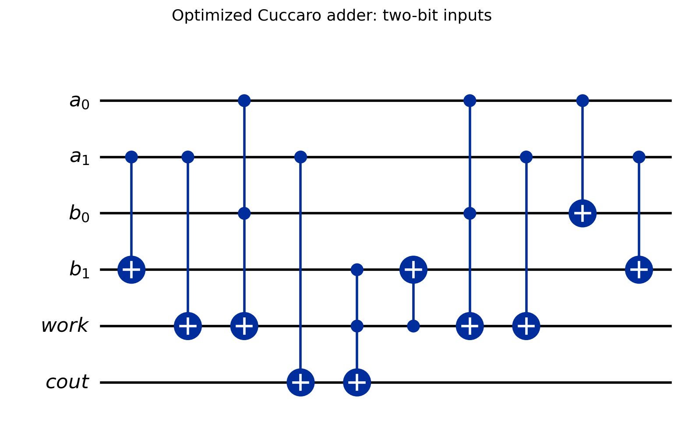
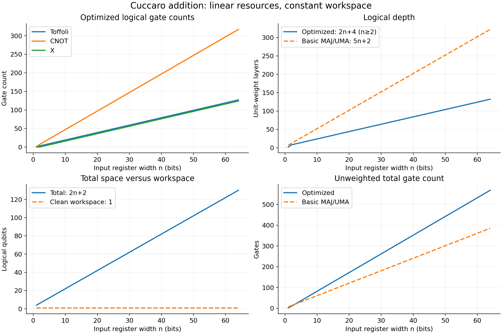

# Cuccaro Ripple-Carry Quantum Adder

**A from-scratch implementation of a reversible, unsigned quantum adder in Qiskit, with circuit visualization, resource analysis, and automated tests.**

This project implements the ripple-carry addition circuit of [Cuccaro, Draper, Kutin, and Moulton (2004)](https://arxiv.org/abs/quant-ph/0410184). The circuit is assembled explicitly from **X, CNOT (`cx`), and Toffoli (`ccx`) gates**—not from Qiskit's built-in arithmetic circuits or synthesis routines. It accepts arbitrary positive register widths and can be incorporated into larger quantum algorithms.

Alongside the optimized Cuccaro construction, the library includes a simpler **MAJ/UMA ripple-carry adder** for comparison, tools for counting quantum resources, a fully worked Jupyter notebook, and a pytest verification suite.

## What does the library do?

Given two unsigned `n`-bit integers, the adder adds them **coherently and reversibly**. It preserves the first operand, replaces the second with the low `n` bits of the sum, and writes any overflow into a dedicated carry-out qubit:

$$
|a\rangle|b\rangle|0\rangle|z\rangle
\;\longmapsto\;
|a\rangle\,|(a+b)\bmod 2^n\rangle\,|0\rangle\,
\left|z\oplus\left\lfloor\frac{a+b}{2^n}\right\rfloor\right\rangle.
$$

Here `z` is the initial state of the carry-output bit (normally zero). If `z=0`, the `n` sum bits and the carry-out bit together represent the complete `(n+1)`-bit result.

For example, **3 + 5 = 8** with three-bit operands:

- `a = 011` remains `011`.
- `b = 101` becomes `000`, the low three bits of `1000`.
- `cout = 1` holds the high bit, so the full answer is `1000`.
- The workspace qubit starts and ends in `0`.

Unlike a classical function that simply returns an integer, `build_adder()` creates a **unitary quantum circuit**. It can operate on superpositions or entangled inputs without measuring them. `addition_circuit()` is a convenient wrapper for preparing ordinary integer inputs.

### Qubit layout

The library uses `2n + 2` qubits in four registers, ordered as follows:

| Register | Width | Initial role | Final role |
| --- | ---: | --- | --- |
| `a` | `n` | First operand | Preserved unchanged |
| `b` | `n` | Second operand | `(a + b) mod 2^n` |
| `work` | `1` | **Must begin in `0`** | Restored to `0` |
| `cout` | `1` | Carry target, typically `0` | Carry-out XOR initial target |

The least significant bit of each input register is indexed `0`. The global qubit order is `a[0:n]`, `b[0:n]`, `work`, `cout`. **`work` is not an incoming carry bit**; this API implements addition without carry-in.

## How is the adder implemented?

For each bit position `i`, ordinary binary addition uses the sum and carry relations

$$
s_i = a_i \oplus b_i \oplus c_i,
\qquad
c_{i+1} = a_i b_i \oplus a_i c_i \oplus b_i c_i.
$$

The carry is a *majority* function of the two operand bits and the incoming carry. In the Cuccaro approach, carry information **ripples from the least significant bit toward the most significant bit**, then a reverse pass uncomputes intermediate information while forming the sum.

The basic implementation (`method="maj_uma"`) makes this especially clear:

1. **MAJ (majority) operations** propagate carries forward, temporarily modifying the `a` register.
2. The final carry is copied to `cout`.
3. **UMA (unmajority-and-add) operations** run backward, restoring the original `a` bits and the scratch qubit while leaving the sum in `b`.

The default implementation (`method="optimized"`) follows the more efficient scheduling from **Section 3, Figure 5** of the Cuccaro paper. It rearranges and overlaps operations on independent qubits to reduce logical depth and save one Toffoli compared with the basic chain. The code includes explicit boundary cases for widths of one, two, and three bits.

Both implementations are written gate by gate in [`src/cuccaro_adder/circuits.py`](src/cuccaro_adder/circuits.py). Neither relies on a built-in adder, and neither requires an additional carry register for every input bit.



*The two-bit circuit above shows the uninitialized, measurement-free arithmetic block. Controls are dots; CNOT targets are circled plus signs.*

## Installation

**Requirements:** Python 3.10 or newer; Qiskit 2.x. Python 3.12 is a convenient choice for this project. You do **not** need an IBM Quantum account, quantum hardware, or Qiskit Aer to run the provided demonstrations.

### Recommended: uv

Clone the repository (replace the URL with this repository's actual GitHub URL) or download and extract the project ZIP. Open a terminal in the directory containing `pyproject.toml`.

```bash
# After cloning or extracting, from the repository root:
uv sync --all-extras
```

This creates the project's `.venv` environment and installs the library plus the `dev` and `demo` dependencies, including pytest, Ruff, JupyterLab, and Matplotlib. Since `uv.lock` is included, uv can reproduce the resolved dependency set.

On **Windows Command Prompt**, navigate to the extracted project with, for example:

```cmd
cd /d "%USERPROFILE%\python-projects\cuccaro-adder"
uv sync --all-extras
```

There is no need to activate `.venv` manually when using `uv run`.

### Alternative: pip

If you do not use uv, install the package in a virtual environment:

```bash
python -m pip install -e ".[dev,demo]"
```

This editable installation lets you modify the source code without reinstalling the library each time. The package alone can be installed with `python -m pip install -e .`.

## Usage examples

### 1. Add two ordinary integers

```python
from qiskit.quantum_info import Statevector
from cuccaro_adder import addition_circuit, decode_output

# Creates a three-bit adder and prepares a=3, b=5 with X gates.
qc = addition_circuit(3, 5)

# Simulate this small, deterministic basis-state example.
state = Statevector.from_instruction(qc)
final_index = int(state.probabilities().argmax())
result = decode_output(final_index, num_bits=3)

print(result.a)          # 3 (unchanged)
print(result.sum_low)    # 0 (low three sum bits)
print(result.carry_out)  # 1 (overflow bit)
print(result.work)       # 0 (clean workspace)
print(result.total)      # 8 (the complete sum)
```

`addition_circuit(a, b)` automatically chooses enough bits for both nonnegative operands. You can override the width with `num_bits=...` to add zero padding, but it will reject a width too small for either input. Neither circuit-construction function executes a simulation by itself.

**Note:** Choosing the most probable state as above is appropriate only for a deterministic, computational-basis input. For superpositions, inspect the full statevector or use an appropriate measurement procedure instead.

### 2. Build a reusable quantum arithmetic block

```python
from qiskit import QuantumCircuit
from cuccaro_adder import build_adder

adder = build_adder(2)             # The optimized two-bit adder
print(adder.draw(output="text"))    # Text circuit diagram

qc = QuantumCircuit(*adder.qregs)
qc.h(0)                            # Put the lowest bit of a in superposition
qc.x(2)                            # Prepare b = 1
qc.compose(adder, inplace=True)    # Apply the adder coherently
```

`build_adder(n)` creates a unitary circuit with no input preparation, measurement, or simulation. Its default method is `"optimized"`; use `build_adder(n, method="maj_uma")` for the basic construction. You can also use the returned circuit as a gate or compose it with a larger circuit, preserving the register order.

### 3. Count gates and other resources

```python
from cuccaro_adder import (
    adder_resources,
    build_adder,
    count_resources,
    expected_gate_counts,
    resource_scaling,
)

logical = adder_resources(8)
print(logical.num_qubits)     # 18
print(logical.operations)     # {'cx': 37, 'ccx': 15, 'x': 12}
print(logical.depth)          # Logical circuit depth

# Check the implemented circuit against analytical gate formulas.
assert logical.operations == expected_gate_counts(8)

# Count the circuit in a smaller elementary basis instead of treating
# each Toffoli as one indivisible logical gate.
elementary = count_resources(
    build_adder(8),
    basis_gates=["x", "h", "t", "tdg", "cx"],
    optimization_level=0,
)
print(elementary.t_count)

# Generate rows for plots/tables, without simulating a quantum state.
rows = resource_scaling(range(1, 65))
```

The `ResourceCount` object includes qubit and classical-bit counts, gate count, logical depth, counts by gate arity, an operation breakdown, Toffoli count, and T/T-dagger count. Use `logical.to_dict()` to export its data. Counts from `adder_resources()` omit the gates used to initialize a particular pair of integers; `count_resources(addition_circuit(...))` includes them.

### Public API at a glance

| Function / object | Purpose |
| --- | --- |
| `build_adder(num_bits, method="optimized")` | Construct an uninitialized, reusable quantum adder. |
| `addition_circuit(a, b, num_bits=None, method="optimized")` | Prepare nonnegative integer operands, then apply the adder. |
| `decode_output(index, num_bits)` | Interpret a standard-order computational-basis output as an `AdditionOutput`. |
| `AdditionOutput` | Holds the preserved input, low sum, workspace value, carry-out, and full `total`. |
| `count_resources(circuit, ...)` | Count resources in a circuit, optionally after gate-basis decomposition. |
| `adder_resources(num_bits, ...)` | Construct and count the bare adder. |
| `expected_gate_counts(num_bits, ...)` | Return analytical gate counts for comparison. |
| `resource_scaling(widths, ...)` | Collect circuit-count data over multiple register widths. |
| `ResourceCount` | Structured resource results, with a `to_dict()` method. |

## Resource scaling

A major benefit of Cuccaro's ripple-carry design is that its gate counts, qubit count, and logical depth grow **linearly** with the number of operand bits.

For the **bare** adder, excluding input-preparation gates, the library implements these formulas for `n >= 2`:

| Resource | Optimized Cuccaro | Basic MAJ/UMA |
| --- | ---: | ---: |
| Total qubits | `2n + 2` | `2n + 2` |
| Workspace qubits | 1 | 1 |
| Toffoli (`ccx`) | `2n - 1` | `2n` |
| CNOT (`cx`) | `5n - 3` | `4n + 1` |
| X | `2n - 4` | 0 |
| Total logical gates | `9n - 8` | `6n + 1` |
| Logical depth | `2n + 4` | `5n + 2` |

The optimized **one-bit** circuit is a special half-adder case: one Toffoli, one CNOT, and depth two. Its register interface still includes the workspace qubit, even though that qubit is unused.



*Resource scaling measured directly from constructed Qiskit circuits. The notebook also compares the basic and optimized implementations and investigates a decomposition into X, H, T, T-dagger, and CNOT gates.*

**Logical depth is not hardware execution time.** In the table, a three-qubit Toffoli counts as one logical gate. Realizing a Toffoli in a smaller gate set requires additional gates, and compiling to a particular device may require routing and other overhead. The optional basis decomposition reports **hardware-independent** elementary counts, not a hardware-specific cost or fault-tolerance estimate. Likewise, a native-basis T-count of zero does not imply that Toffoli gates have zero non-Clifford cost.

An important tradeoff is that the optimized construction reduces **depth and Toffoli count**, not necessarily the total number of unweighted gates or elementary CNOTs. Both methods remain `O(n)` in the resources tabulated here.

## Jupyter notebook

Open the included notebook in JupyterLab:

```bash
uv run --all-extras jupyter lab notebooks/cuccaro_adder_demo.ipynb
```

Alternatively, run `uv run --all-extras jupyter lab`, then open [`notebooks/cuccaro_adder_demo.ipynb`](notebooks/cuccaro_adder_demo.ipynb) from the file browser. Select the Python environment for this project and choose **Run → Run All Cells**.

The notebook contains a guided demonstration of the register layout; small-number addition; a two-bit gate diagram; the MAJ/UMA idea; coherent addition on a superposition; comparisons between basic and optimized circuits; logical and decomposed resource-scaling plots; and verification of the implementation. Its saved outputs can be viewed on GitHub without rerunning the notebook. Generated figures and a resource-count CSV are available in [`figures/`](figures/).

**Simulation limit:** Exact statevector simulation requires `2^(2n+2)` complex amplitudes and grows exponentially with input width. Constructing a circuit or counting its gates does not require allocating that statevector, so the notebook uses small widths for simulation and larger widths for resource analysis.

## Testing and code quality

From the repository root, run:

```bash
uv run --all-extras pytest -q
uv run --all-extras ruff check .
uv run --all-extras ruff format --check .
uv build
```

The tests cover exhaustive arithmetic on small input registers, carry-out behavior, preservation of `a`, workspace restoration, inverse-circuit behavior, random complex superpositions, invalid inputs, and gate-count/depth formulas. Long carry-chain tests use an independent reversible-gate interpreter, avoiding the exponential memory cost of simulating hundreds of qubits.

[`VALIDATION.md`](VALIDATION.md) records the original validated environment and a run of **91 passing tests** (November 9, 2026), along with Ruff and notebook checks. The commands above let you reproduce the checks locally.

## Project structure

```text
cuccaro-adder/
├── src/cuccaro_adder/
│   ├── __init__.py           # Public library API
│   ├── circuits.py           # Gate-level adder constructions and decoding
│   ├── resources.py          # Resource counts and scaling tools
│   └── py.typed              # Indicates a typed Python package
├── tests/
│   └── test_cuccaro_adder.py # Functional and resource tests
├── notebooks/
│   └── cuccaro_adder_demo.ipynb
├── figures/                  # Saved circuit/scaling plots and CSV data
├── pyproject.toml            # Package metadata and dependencies
├── uv.lock                   # Reproducible dependency resolutions
├── .python-version          # Preferred Python version for uv
├── .gitignore
├── VALIDATION.md             # Recorded verification results
└── README.md
```

## Scope and limitations

- The library supports **unsigned** addition for `n >= 1`, with no built-in signed arithmetic or carry-in input.
- The workspace qubit must start in `|0⟩`; `cout` is an XOR carry target and should start in `|0⟩` when the output is interpreted as an ordinary full sum.
- The construction is reversible and suitable as a building block in quantum algorithms, but **does not offer a speed advantage over classical addition for ordinary classical integers**.
- The resource-analysis tools measure constructed circuits and optional gate-basis decompositions. They do not estimate physical qubits, error-corrected runtime, or performance on a specific quantum processor.

## References

- S. A. Cuccaro, T. G. Draper, S. A. Kutin, and D. P. Moulton, *[A new quantum ripple-carry addition circuit](https://arxiv.org/abs/quant-ph/0410184)* (2004). The basic MAJ/UMA chain is discussed in Section 2 and the optimized circuit in Section 3, Figure 5.
- [Qiskit `QuantumCircuit` API](https://quantum.cloud.ibm.com/docs/en/api/qiskit/qiskit.circuit.QuantumCircuit) — quantum circuit construction, drawing, and operations.
- [Qiskit `Statevector` API](https://quantum.cloud.ibm.com/docs/en/api/qiskit/qiskit.quantum_info.Statevector) — exact small-circuit simulation and validation.
